  

  

  Undergraduate specializing in <b>Artificial Intelligence & Machine Learning</b>. 
  I build complete software systems — not just models, but the apps, APIs and automation around them.

 

  

  

  

<table align="center">
  <tr>
    <td align="center" width="50%">
      <b>LANGUAGES</b>  
      
    </td>
    <td align="center" width="50%">
      <b>AI / ML &amp; COMPUTER VISION</b>  
      
    </td>
  </tr>
  <tr>
    <td align="center">
      <b>BACKEND · APPS · IOT</b>  
      
    </td>
    <td align="center">
      <b>CLOUD &amp; TOOLS</b>  
      
    </td>
  </tr>
</table>

 

  

  
  

  

  

  
  
  

 

  

